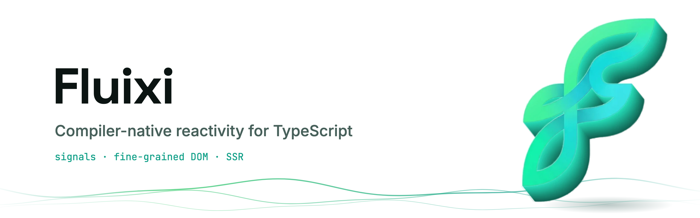

<p align="center">
  <a href="https://fluixi.com">
    <picture>
      <source media="(prefers-color-scheme: dark)" srcset="assets/banner-dark.png" />
      
    </picture>
  </a>
</p>

<p align="center">
  <a href="https://fluixi.com">Website</a> ·
  <a href="https://docs.fluixi.com">Docs</a> ·
  <a href="https://playground.fluixi.com">Playground</a> ·
  <a href="https://www.npmjs.com/org/fluixi">npm</a>
</p>

Fluixi is a compiler-native reactive framework for TypeScript. The compiler knows which values are reactive, so you write ordinary code and the DOM updates exactly where it changed.

## Projects

| | |
| --- | --- |
| [**core**](https://github.com/fluixi/core) | The framework: reactivity, DOM runtime, compiler, SSR and the full-stack `@fluixi/start`. |
| [**examples**](https://github.com/fluixi/examples) | Small runnable apps, each ready to open on StackBlitz. |
| [**icons**](https://github.com/fluixi/icons) | Icon sets as SVG strings, JSX components, sprites and CDN bundles. |
| [**@fluixi-ui**](https://www.npmjs.com/org/fluixi-ui) | Components with switchable skins. |
| [**@fluixi/forms**](https://www.npmjs.com/package/@fluixi/forms) | Typed forms with schema validation. |

## Get started

```sh
npm create fluixi@alpha my-app
```

Fluixi is in alpha: APIs can change between releases.

## Contributing

Issues and pull requests are welcome. Read the [contributing guide](https://github.com/fluixi/.github/blob/main/CONTRIBUTING.md) first, and report vulnerabilities privately as described in the [security policy](https://github.com/fluixi/.github/blob/main/SECURITY.md).
